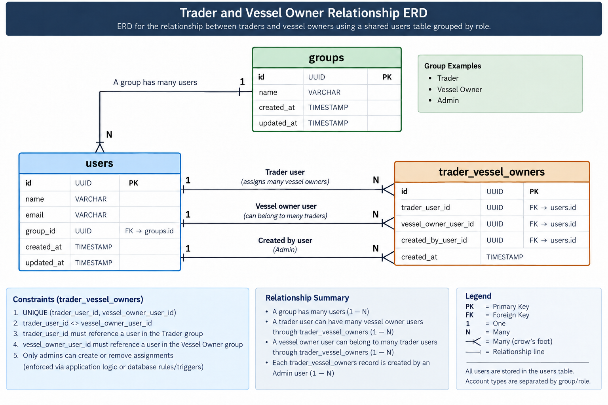

## Tuna Application


## Structure and set up

This app is a django project and is structured to use to multiple settings file defined in:

```
settings/
   base.py  # contains the base default app settings
   ci.py   # contains the ci tool settings
   dev.py  # contains the development app settings
   production.py # contains the production app settings
   staging.py # contains the staging app settings
```

## Setting Up

### Requirements

- Python 3.10
- PostgreSQL

### 1. Create and activate a virtual environment

```bash
python3.10 -m venv .venv
source .venv/bin/activate
```

### 2. Install dependencies

```bash
pip install -r requirements.txt
```

### 3. Create your environment file

Copy `.env.example` to `.env` and add the required values.

### 4. Run migrations
create your local postgres database

```bash
python manage.py migrate
```

### 5. Seed default roles and users

```bash
python manage.py seedrolesandusers
```

This command is important because the mobile app depends on the default roles created by `accounts.management.commands`.

### 6. Sync  Strapi content

Fetch linked content in this order before running the full sync, because `create_content_area` content depends on `case_study` content:

```bash
python manage.py sync_content --collection=ikans --custom-type=case_study
python manage.py sync_content --collection=ikans --custom-type=create_content_area
python manage.py sync_content --collection=ikans
```

You can also sync a specific  custom type:

```bash
python manage.py sync_content --collection=ikans --custom-type=page
```

### 7. Start the development server

```bash
python manage.py runserver
```

## Running tests
1. `coverage run manage.py test` to run tests
1. `coverage report` to generate test report

## WebHooks
The app has some webooks that run with it. e.g. wheh content is updated on prismic, the app is notified via a webhook.
When developing, refer to this [article](https://geekflare.com/expose-django-app-with-ngrok/) to see how the app can get updated content while developing

## Setting up email
To setup email sending in the application
1. add the values for the following env variables
```
EMAIL_HOST=
EMAIL_PORT=
EMAIL_HOST_USER=
EMAIL_HOST_PASSWORD=
APPLICATION_FROM_EMAIL=
```

2. import the `TunaEmailHelper` class and  `EmailTemplate` as well if sending templated email.
3. example
i) without template
```
TunaEmailHelper.tuna_send_email(
   to_emails=[config('APPLICATION_FROM_EMAIL')],
   subject='Call for Applications: Software Developer at Tuna Inc',
   body='Application for the above position'
)
```

ii) with template (must pass the template parameter which can be accessed from `EmailTemplate`)
```
TunaEmailHelper.tuna_send_email(
   template=EmailTemplate.APPLICATION.value,
   to_emails=[config('APPLICATION_FROM_EMAIL')],
   subject='Call for Applications: Software Developer at Tuna Inc',
   body='Application for the above position'
)
```

## Test users and roles
The app mobile depends on the roles defined in `accounts.management.commands` to work correctly.
The management command above creates the default roles  and some users to begin with.
If you are setting up a new installation, ensure that you set up those roles.
To run the command, just run `python manage.py seedrolesandusers`


## Trader and Vessel Owner Relationship ERD


## Translation service

Use `common.services.translation.Translator` for translated UI text in Python, and the `translate` template filter for HTML.

### Current page text

For template calls without an explicit page scope, the translator infers the page from the current URL name using `PAGE_TRANSLATION_MAP` in `common/services/translation.py`.

Example:

```python
PAGE_TRANSLATION_MAP = {
    "dashboard-overview": "traders-dashboard",
    "dashboard-wage-payments": "traders-dashboard",
}
```

The left side is the Django URL name. The right side is the content page key. Use explicit scopes when a template or service needs text from a different page or form.
### Templates

Use the filter directly in templates:

```django
{{ "submit"|translate }}
```

By default, this checks the current page text first, then common text, then form text if configured, then falls back to the key.

To force a source:

```django
{{ "submit"|translate:"common" }}
{{ "email"|translate:"page:auth-common-text" }}
{{ "firstName"|translate:"form:account-setup" }}
```

The filter is registered globally in `tuna/settings/base.py`, so templates do not need ``.

### Python

Use `Translator` in views or services:

```python
from common.services.translation import Translator

translator = Translator(request)
translator.t("submit")
translator.t("workersPast12Months", worker_count=worker_count)
translator.t("email", scope="page:auth-common-text")
```

# API documentation
Currently, the API documentation is done using swagger. To access the documentation, run the app and navigate to `/api/docs/`

The app also includes a  collection that can be used to test the API endpoints. The collection is located at the root of the project and is named `api-collection.json`. If you've never used thunderclient, watch this quick video to get started [here](https://www.youtube.com/watch?v=AbCTlemwZ1k&t=57s&pp=ygUNdGh1bmRlcmNsaWVudA%3D%3D) or this one [here](https://www.youtube.com/watch?v=ubLtI8N6Fq0&pp=ygUNdGh1bmRlcmNsaWVudA%3D%3D)


# linting
The app uses `flake8` for linting. To run linting, run `flake8` in the terminal
